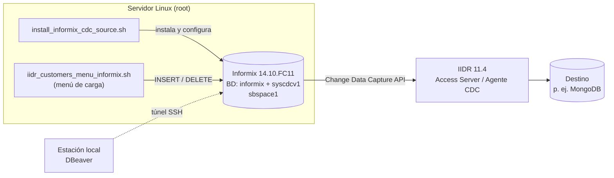

# Informix CDC Enterprise Toolkit

> Kit de automatización para desplegar **IBM Informix 14.10.FC11** como **origen (source)** de **IBM InfoSphere Data Replication (IIDR / CDC) 11.4**, y para generar carga de trabajo de demostración.


**Autor:** Julio César García Hernández — [LinkedIn](https://www.linkedin.com/in/jcgarciahdz/)

---

## Contenido

1. [Descripción general](#descripción-general)
2. [Componentes](#componentes)
3. [Arquitectura](#arquitectura)
4. [Requisitos previos](#requisitos-previos)
5. [Inicio rápido](#inicio-rápido)
6. [Variables de configuración](#variables-de-configuración)
7. [Generador de datos de demostración](#generador-de-datos-de-demostración)
8. [Consideraciones de seguridad](#consideraciones-de-seguridad)
9. [Documentación adicional](#documentación-adicional)
10. [Contribuciones y licencia](#contribuciones-y-licencia)
11. [Autoría](#autoría)

## Descripción general

Este repositorio reúne dos scripts Bash que cubren el ciclo completo de un laboratorio de replicación de datos con Informix como origen:

| Fase | Objetivo | Script |
|------|----------|--------|
| 1. Aprovisionamiento | Instalar y configurar Informix listo para CDC | [`install_informix_cdc_source.sh`](scripts/install_informix_cdc_source.sh) |
| 2. Generación de carga | Producir inserciones y borrados capturables por IIDR | [`iidr_customers_menu_informix.sh`](scripts/iidr_customers_menu_informix.sh) |

Casos de uso típicos: pruebas de concepto (PoC), laboratorios, demostraciones de replicación Informix → MongoDB (u otros destinos soportados por IIDR) y validación de requisitos previos de CDC.

## Componentes

```
.
├── README.md
├── CHANGELOG.md
├── CONTRIBUTING.md
├── SECURITY.md
├── LICENSE
├── .gitignore
├── docs/
│   ├── INSTALACION.md        # Guía paso a paso del instalador
│   ├── DEMO-IIDR.md          # Guía del generador de datos y flujo de demo
│   └── TROUBLESHOOTING.md    # Problemas conocidos y soluciones
└── scripts/
    ├── install_informix_cdc_source.sh
    └── iidr_customers_menu_informix.sh
```

## Arquitectura



## Requisitos previos

- Linux x86_64 (RHEL/Rocky/Alma con `dnf`/`yum`, o Debian/Ubuntu con `apt-get`) y acceso **root**.
- Instaladores de Informix proporcionados por IBM (no incluidos en este repositorio):
  - `INFM_DEV_V14.10.FC11_LNX_X86_64.zip` (obligatorio)
  - `INFM_ADV_ENTER_LIC_INS_V14.11.FC1.zip` (opcional: licencia Advanced Enterprise Edition)
- Conectividad a los repositorios del sistema operativo (para paquetes y Java).
- Espacio en disco ≈ 4 GB para los chunks por defecto, más el espacio de instalación.

## Inicio rápido

```bash
# 1. Clonar el repositorio
git clone <URL_DEL_REPOSITORIO> informix-cdc-enterprise-toolkit
cd informix-cdc-enterprise-toolkit

# 2. Copiar los instaladores de IBM a /opt (o definir SRC_DIR)
cp INFM_DEV_V14.10.FC11_LNX_X86_64.zip INFM_ADV_ENTER_LIC_INS_V14.11.FC1.zip /opt/

# 3. Instalar Informix como origen CDC (como root)
sudo IFX_PASS='<contraseña_segura>' ./scripts/install_informix_cdc_source.sh

# 4. Generar datos de demostración (como root o informix)
sudo ./scripts/iidr_customers_menu_informix.sh
```

El instalador es **idempotente**: puede volver a ejecutarse y omitirá los pasos ya completados. Su bitácora queda en `/var/log/install_informix_cdc.log`.

## Variables de configuración

Todas se sobrescriben por entorno. Resumen de las principales (detalle completo en [`docs/INSTALACION.md`](docs/INSTALACION.md)):

| Variable | Valor por defecto | Descripción |
|----------|-------------------|-------------|
| `SRC_DIR` | `/opt` | Directorio con los `.zip` de instalación |
| `INFORMIXDIR` | `/opt/informix` | Directorio de instalación |
| `SERVERNAME` | `ifxsrc` | Nombre del servidor (`DBSERVERNAME`) |
| `PORT` | `9088` | Puerto TCP (`onsoctcp`) |
| `LISTEN_ADDR` | `127.0.0.1` | Dirección de escucha (loopback + túnel SSH) |
| `DB_NAME` | `informix` | Base de datos fuente con logging |
| `CDC_USER` | `informix` | Usuario del SO con el que se conecta IIDR |
| `IFX_PASS` | `informix` | Contraseña del usuario del SO — **cámbiala** |
| `APPLY_LICENSE` | `yes` | Aplicar licencia Advanced Enterprise Edition |

## Generador de datos de demostración

`iidr_customers_menu_informix.sh` ofrece un menú interactivo sobre la tabla `customers`:

| Opción | Acción |
|--------|--------|
| 1 | Limpiar la tabla (`DELETE`, genera eventos de borrado capturables) |
| 2 | Limpiar y cargar exactamente 1000 registros |
| 3 / 4 / 5 | Agregar 10 / 100 / 1000 registros |
| 6 | Mostrar conteo y configuración |
| 7 | Mostrar los últimos 10 registros |
| 8 | Crear la tabla `customers` si no existe |
| 0 | Salir |

Más detalle en [`docs/DEMO-IIDR.md`](docs/DEMO-IIDR.md).

## Consideraciones de seguridad

- La contraseña por defecto (`IFX_PASS=informix`) es **solo para laboratorio**. Defínela siempre por entorno en cualquier otro escenario.
- El instalador imprime las credenciales en el resumen final y en `/var/log/install_informix_cdc.log`; protege o elimina ese archivo tras la instalación.
- Por defecto Informix escucha solo en `127.0.0.1`; el acceso remoto se hace por **túnel SSH**.
- Consulta [`SECURITY.md`](SECURITY.md) para el reporte de vulnerabilidades.

## Documentación adicional

- [Guía de instalación](docs/INSTALACION.md)
- [Guía de demostración con IIDR](docs/DEMO-IIDR.md)
- [Solución de problemas](docs/TROUBLESHOOTING.md)
- [Registro de cambios](CHANGELOG.md)

## Contribuciones y licencia

Las contribuciones son bienvenidas; revisa [`CONTRIBUTING.md`](CONTRIBUTING.md). Distribuido bajo licencia [MIT](LICENSE).

> IBM, Informix e InfoSphere son marcas registradas de International Business Machines Corporation. Este proyecto es independiente y no constituye un producto oficial de IBM; el software de IBM debe obtenerse y licenciarse conforme a sus términos.

## Autoría

**Julio César García Hernández**
Creador y mantenedor del proyecto.

[](https://www.linkedin.com/in/jcgarciahdz/)

Perfil profesional: <https://www.linkedin.com/in/jcgarciahdz/>
